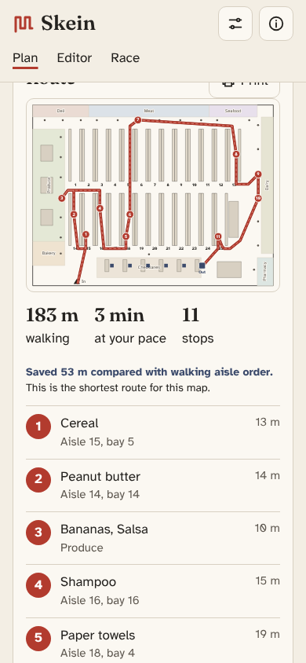

# Skein

Skein plans the shortest walk through one grocery store, from the entrance, past everything on your list, to the registers.



**Live:** [kenchollacoop2005.github.io/Skein](https://kenchollacoop2005.github.io/Skein/)

## Why

I'm disabled, and every extra lap of the store costs me more than it costs most people. So I wanted a tool that plans the shortest walk past everything on my list before I go in. It also helps anyone who's in a hurry.

## How it works

**Data.** The Kroger Public API gives the aisle, bay and side for each product at a specific store. A Node script looks up about 320 common items at the Kroger on University City Blvd in Blacksburg (store 02900210, at the Prices Fork Road corner) and saves only what routing needs into `data/catalog.json`. The secret key stays on my computer and never reaches the browser. Notes on what the data looks like are in [docs/kroger-data.md](docs/kroger-data.md).

**Store model.** The layout is a JSON file in meters: the outline, entrance, registers, numbered aisles with bay counts, wall departments like Dairy and Meat, and obstacles. Skein turns it into a 0.5 m walking grid with a little clearance from the shelves, and uses Dijkstra's algorithm to get true walking distances between every pair of stops. The shipped layout is a placeholder until I trace the real store with the built-in editor on my phone.

**Routing.** Start at the entrance, visit every stop, end at whichever register makes the trip shortest. Up to 16 stops, Skein uses Held and Karp dynamic programming, which finds the exact shortest order. Above 16 it uses nearest neighbor plus 2-opt and Or-opt with restarts, and a Lagrangian spanning tree bound to say how close it is to the best possible. There are options to leave cold items for last and to make fewer turns into aisles.

**The race.** The race page compares the planners with two slime mold models. The Tero, Kobayashi and Nakagaki tube model grows a network between the items, and the route walks that network. The Jones agent model is shown as an animation.

## The race

From `node tools/race.mjs` on the placeholder layout with the real catalog. The mold rows are the mean and best of three seeds.

| List | Method | Route length | Above best |
|---|---|---|---|
| 12 items (11 stops) | Exact optimal | 183 m | best |
| | Nearest neighbor | 214 m | 16.4% |
| | Aisle order | 237 m | 29.0% |
| | Slime mold network, mean | 213 m | 16.3% |
| | Slime mold network, best seed | 194 m | 5.9% |
| 25 items (24 stops) | Near optimal (bound 279 m) | 287 m | best |
| | Nearest neighbor | 318 m | 10.7% |
| | Aisle order | 343 m | 19.5% |
| | Slime mold network, mean | 366 m | 27.3% |
| | Slime mold network, best seed | 340 m | 18.4% |

The mold never beats the solver. On the 12 item list it about ties nearest neighbor on average and beats aisle order. On the 25 item list it loses to both, because the network doesn't say what order to walk it in.

<details>
<summary>Running locally</summary>

No build step. Serve the folder with any static server, for example:

```
npm run serve
```

Then open `http://localhost:8080/`. Tests run with `npm test` (Node 22 or newer). `npm run qa` takes screenshots, checks the print layout and offline mode, and needs Playwright.
</details>

<details>
<summary>Rebuilding the catalog</summary>

Get a client ID and secret from the Kroger developer site, then:

```
export KROGER_CLIENT_ID=...
export KROGER_CLIENT_SECRET=...
node tools/kroger.mjs locations 24060
KROGER_LOCATION_ID=02900210 node tools/build-catalog.mjs
```

The item list is `tools/starter-items.txt`. Calls are paced 350 ms apart and capped well under the daily limit.
</details>

<details>
<summary>Optional live lookup proxy</summary>

`proxy/worker.js` is a small Cloudflare Worker that holds the secret and searches one store. It lets the app look up items that aren't in the saved catalog. Deploy steps are in [proxy/README.md](proxy/README.md). Paste the worker URL into Settings, Live lookup URL.
</details>

<details>
<summary>Project layout</summary>

```
index.html          list, route, map
editor.html         store map editor
race.html           slime mold versus the planners
js/store.js         layout model, validation, walk grid
js/graph.js         Dijkstra, A*, all pairs
js/route.js         Held and Karp, heuristics, lower bound
js/match.js         list text to catalog items
js/plan.js          glue between the list, map and solver
js/physarum.js      Tero and Jones slime mold models
data/store.json     placeholder layout
data/catalog.json   item locations for store 02900210
tools/              Kroger scripts, QA screenshots, race table
proxy/              optional Cloudflare Worker
tests/              node --test
```
</details>

## Credits

- Fonts: [Atkinson Hyperlegible](https://www.brailleinstitute.org/freefont/) by the Braille Institute and [Fraunces](https://github.com/undercasetype/Fraunces), both under the SIL Open Font License (see `fonts/`).
- Product locations from the Kroger Public API.
- Full reference list: [docs/references.md](docs/references.md).

## License

MIT, Copyright (c) 2026 Ken Chollacoop. See [LICENSE](LICENSE).

**Ken Chollacoop** · [GitHub](https://github.com/KenChollacoop2005) · [Portfolio](https://kenchollacoop2005.github.io/Bulletin/)
